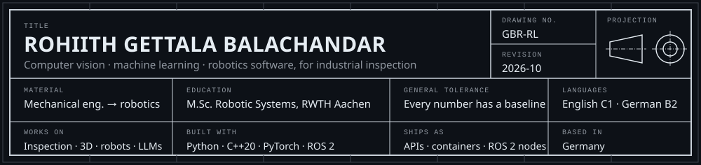

I spent three years designing industrial machines (clamping units, FEM studies, series release)
before I moved to robotics at RWTH Aachen. Now I build the software that lets cameras and robots
judge parts.

**Right now:** my master's thesis at **TRUMPF**, *"Evaluating the realism of synthetic training
data for vision-based dimensional inspection of sheet metal parts"*. I generate training images
by rendering instead of photographing, train inspection models on them, and work out how
realistic the renderings need to be for the models to hold up on real cameras.

The machine side taught me three things I still work by. A tolerance is a promise, so every result
comes with the baseline it beats. The test has to look like the field, so I split data by time, by
project or by part family. And the hardware is part of the specification, so every project reports its latency and memory
on the machine it was measured on.

## Projects

Each one is built the way it would ship (an API, containers, CI, a pipeline you can rerun) and
measured against the simple solution it has to beat. The numbers come from the runs in each
repository.

| project | what I built | result | the decision it led to |
|---|---|---|---|
| [vlm-inspect](https://github.com/GBR-RL/vlm-inspect) | Inspection service comparing an open vision-language model with a trained YOLO detector: FastAPI, PostgreSQL + pgvector, MLflow, Kubernetes | YOLO: 0.95 AUROC at 0.07 s per part. Qwen3-VL: 0.88 with no defect labels at all | the VLM triages new defect types while labels are collected; the detector runs inline |
| [takt-vision](https://github.com/GBR-RL/takt-vision) | C++20 inference runtime: lock-free stages, ONNX Runtime, ByteTrack, no allocations per frame | p99 latency of 74 ms with a camera faster than the model, against 4 s for a plain queue | keep the newest frame and drop the rest: bounded latency matters more than raw speed |
| [posegrasp](https://github.com/GBR-RL/posegrasp) | 6-DoF pose estimation to grasp planning, ROS 2 + MoveIt 2 nodes, physics check in MuJoCo | 69% grasp success from estimated poses on the BOP LM-O benchmark (58% with zero-shot detections) | plan the grasp for the pose error: +12 to 20 points of success |
| [drivecast](https://github.com/GBR-RL/drivecast) | Data and MLOps pipeline over 744M rows: Parquet lake, MLflow registry, champion/challenger gate, API on Kubernetes, weekly retraining | 3.5× the average precision of the vendor's own SMART rule, better in 45 of 45 quarters | retrain on data drift: better than a yearly schedule at the same cost |
| [spec-review](https://github.com/GBR-RL/spec-review) | Requirements reviewer as a GitHub Action and CLI: INCOSE rules, LoRA-tuned 0.6B model, ReqIF, trace graph in Neo4j | 0.69 macro-F1 classifying requirements of unseen projects, against 0.53 for TF-IDF | rule checks run on every pull request; the LLM proposes the rewrites |
| [first-reply](https://github.com/GBR-RL/first-reply) | Service-desk triage on local LLMs: German/English hybrid search, cited reply drafts, approval workflow in n8n, LiteLLM gateway, tracing | retrieval nDCG@10 of 0.69 (English) and 0.65 (German); no restricted document leaked in 780 queries | a confidence gate decides what is automated and hands the rest to a person |
| [shopfloor-agent](https://github.com/GBR-RL/shopfloor-agent) | On-prem maintenance agent: LangGraph, plant data through MCP servers, llama.cpp | a 4B open model solves 142 of 143 tasks | sanitise tool output or gate writes: either one stopped every injected write |

Earlier work: [DeepInspect3D](https://github.com/GBR-RL/DeepInspect3D), CAD-referenced 3D
inspection with point cloud registration and deviation maps, and
[SmartSort-CAM](https://github.com/GBR-RL/SmartSort-CAM), a part classifier trained only on
Blender renders, with Grad-CAM and a FastAPI service.

## Toolbox

- **Vision and 3D:** PyTorch, OpenCV, YOLO, U-Net, ConvNeXt, Open3D, point cloud registration (PPF, FPFH, ICP), Blender for synthetic data
- **Robotics:** ROS 2, MoveIt 2, MuJoCo
- **Models and LLMs:** scikit-learn, LightGBM, LoRA, llama.cpp, retrieval (BM25, Qdrant, pgvector), LangGraph, MCP
- **Data and MLOps:** DuckDB, Spark, MLflow, ClearML, Docker, Kubernetes, FastAPI, PostgreSQL, GitHub Actions, Azure DevOps
- **Languages:** Python, C++20, SQL
- **From the machine side:** FEM (ANSYS), CAD (Creo), PLM

## Kurz auf Deutsch

Ich bin Maschinenbauer und habe drei Jahre lang Industriemaschinen konstruiert, bevor ich an der
RWTH Aachen Robotic Systems Engineering (M.Sc.) studiert habe. In meiner Masterarbeit bei TRUMPF
untersuche ich, wie realistisch synthetische Trainingsdaten für die kamerabasierte Maßprüfung von
Blechteilen sein müssen. Daneben entwickle ich Bildverarbeitung und maschinelles Lernen für die industrielle Prüfung, Software für Roboter und
die Pipelines und Dienste dahinter. Jedes Ergebnis hier steht neben der einfachen Lösung, die es
schlagen muss, und jedes Projekt misst auch Laufzeit und Speicher auf der Hardware, auf der es lief. Deutsch B2, Englisch C1.

---

[gbrohiith@gmail.com](mailto:gbrohiith@gmail.com) · [LinkedIn](https://www.linkedin.com/in/rohiithgb)
